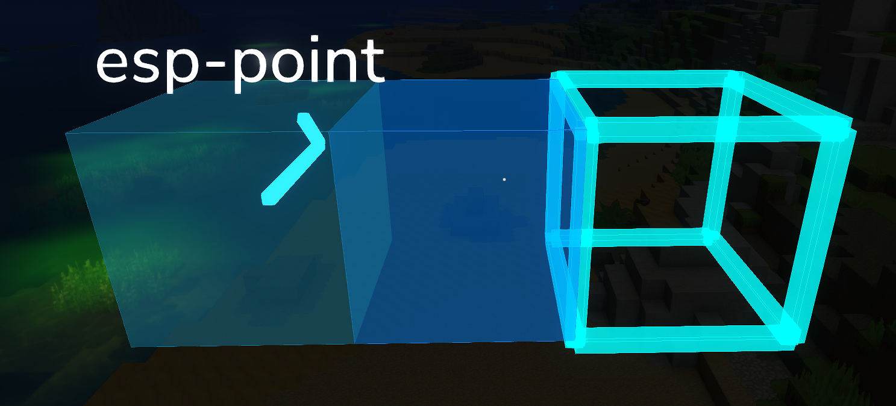

# Markers and Overlays

Client-bound packets used for editor markers, trigger-volume viewing and
debug overlays. These are visual-only; the client does not send an
acknowledgement for them.

## Observed rendering

On the tested client build:

- A point marker (`PointDisplayEntry`) remained visible through solid terrain
  at long range.
- Trigger-volume boxes arrived at the client but were not visibly rendered
  through terrain.
- `BuilderToolLaserPointer` beams were not visibly rendered through terrain.
- `DisplayDebug` shapes were depth-tested: solid and wireframe shapes were
  hidden by blocks. Setting undocumented high bits (`8`, `16`, `32`, `64`,
  `128`) in the `DisplayDebug` flags byte did not change this.

These are client rendering observations, not guarantees. They may differ with
client version, client settings or whether the relevant editor/tool UI is
active.



Open-air comparison from left to right: point marker (labelled `esp-point`),
trigger-volume box, and laser-pointer box.

## PointDisplayEntry

A world-space point marker. Used by the points/editor system.

```text
0   null bits                 u8
    bit0 name, bit1 tags
1   position                  Vector3f   (3 x f32)
13  rotation                  Vector3f   (3 x f32)
25  shape                     u8         PointShapeType
26  id offset                 i32        relative to variable block at byte 38
30  name offset               i32
34  tags offset               i32
38  variable block
```

The variable block starts at byte 38. `id` is required and is a VarString.
`name` is an optional VarString. `tags` is an optional dictionary:
VarInt count followed by that many key/value VarString pairs.

Client behaviour for these fields:

- `id` must be non-empty and unique within the list. Entries with an empty id
  are not rendered by the tested client.
- `name` and `tags` may be absent (`-1` offsets). When `name` is absent the
  client displays `id` as the marker label.
- An `id` consisting only of spaces renders a blank label; other whitespace or
  zero-width characters can render as replacement glyphs.

Observed client behavior: `PointShapeType.Block` rendered as a translucent
block-sized volume with the point `id` shown as a floating label above it.

`PointShapeType`:

```text
0 Block
1 Sphere
```

## Client stage

Point, trigger-volume and other display overlays are stage-gated by the
client. They are accepted only once the client is in the Playing stage;
sending them during `SettingUp` is rejected by the client.

`ClientReady` (105) and early client movement packets do not reliably indicate
that the client has entered Playing. In the server join sequence, `JoinWorld`
(104) is followed by client readiness and then by `SetClientId` (100) from
`World.onFinishPlayerJoining`; `SetClientId` is the first unambiguous
join-complete marker in observed traffic. See [Joining and client
stage](09-other-packets.md#joining-and-client-stage).

## UpdatePointDisplay (518)

Replaces the client's point-marker set.

```packet
bound: client
summary: Replace all point markers
columns: Offset | Field Name | Field Type | Null bit | Notes
0 | Null bits | `u8` | | bit0 `points`
```

Variable block starts at byte 1: VarInt count followed by that many
`PointDisplayEntry` values. An absent array clears the marker set.

## AddOrUpdatePointDisplay (519)

Adds or replaces one marker by id.

```packet
bound: client
summary: Add or update one point marker
columns: Offset | Field Name | Field Type | Notes
0 | `pointId` offset | `i32` | Relative to variable block at byte 8
4 | `entry` offset   | `i32` | Relative to variable block at byte 8
```

Variable block starts at byte 8: `pointId` VarString followed immediately by
one `PointDisplayEntry`.

## RemovePointDisplay (520)

Removes one marker by id.

```packet
bound: client
summary: Remove one point marker
```

Body is a single VarString `pointId`.

## TriggerVolumeDisplayEntry

Editor overlay for a trigger volume.

```text
0   null bits                 u8
    bit0 name, bit1 groupId, bit2 effectAssetRef
1   shapeType                 u8
2   position                  Vector3f   (3 x f32)
14  dimensions                Vector3f   (3 x f32)
26  color                     Vector3f   (3 x f32)
38  opacity                   f32
42  groupColor                i32
46  targetTypes               u8
47  bool bits                 u8
    bit0 keepLoaded, bit1 cancelDelayedOnExit
48  cooldown                  f32
52  cooldownMode              u8
53  activationDelay           f32
57  conditionTiming           u8
58  rotation                  Vector3f   (3 x f32)
70  volumeId offset           i32
74  name offset               i32
78  groupId offset            i32
82  effectAssetRef offset     i32
86  variable block
```

Variable block starts at byte 86. `volumeId` is required and is a VarString;
the other strings are optional. Offsets are relative to the variable block,
with `-1` meaning absent. Optional strings are serialized in field order:
`volumeId`, `name`, `groupId`, `effectAssetRef`.

`TriggerVolumeShapeType`:

```text
0 Box
1 Sphere
2 Cylinder
```

Server-side geometry meaning:

- Box: `position` is the centre; `dimensions` are half-extents.
- Sphere: `position` is the centre; `dimensions.x` is the radius.
- Cylinder: `position` is the centre; `dimensions.x` is the radius and
  `dimensions.y` is the height.

`targetTypes` bitmask:

```text
1 Player
2 NPC
4 Item drop
8 Projectile
```

`cooldownMode`:

```text
0 Per entity
1 Total
```

`conditionTiming`:

```text
0 Before volume delay
1 After volume delay
```

## UpdateTriggerVolumeDisplay (470)

Replaces the client's trigger-volume overlay set.

```packet
bound: client
summary: Replace all trigger-volume overlays
columns: Offset | Field Name | Field Type | Null bit | Notes
0 | Null bits | `u8` | | bit0 `volumes`
```

Variable block starts at byte 1: VarInt count followed by that many
`TriggerVolumeDisplayEntry` values. Null `volumes` clears the overlay set.

## AddOrUpdateTriggerVolumeDisplay (471)

Adds or replaces one trigger-volume overlay by id.

```packet
bound: client
summary: Add or update one trigger-volume overlay
columns: Offset | Field Name | Field Type | Notes
0 | `volumeId` offset | `i32` | Relative to variable block at byte 8
4 | `entry` offset    | `i32` | Relative to variable block at byte 8
```

Variable block starts at byte 8: `volumeId` VarString followed immediately by
one `TriggerVolumeDisplayEntry`.

## RemoveTriggerVolumeDisplay (472)

Removes one trigger-volume overlay by id.

```packet
bound: client
summary: Remove one trigger-volume overlay
```

Body is a single VarString `volumeId`.

## BuilderToolLaserPointer (419)

Draws a timed laser segment between two world-space points.

```packet
bound: client
summary: Timed laser-pointer segment
columns: Offset | Field Name | Field Type | Notes
0  | `playerNetworkId` | `i32`
4  | `startX`          | `f32`
8  | `startY`          | `f32`
12 | `startZ`          | `f32`
16 | `endX`            | `f32`
20 | `endY`            | `f32`
24 | `endZ`            | `f32`
28 | `color`            | `i32` | RGB integer
32 | `durationMs`       | `i32`
```

Observed client behavior: the beam is depth-tested and was not visible through
solid blocks at distance.
